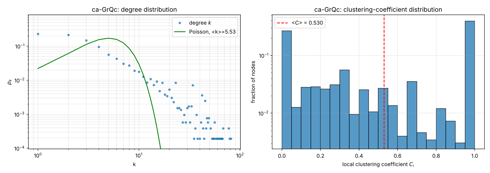
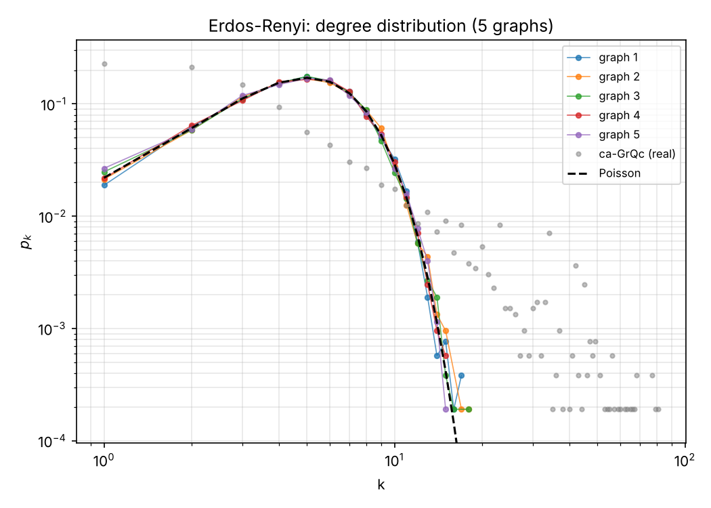
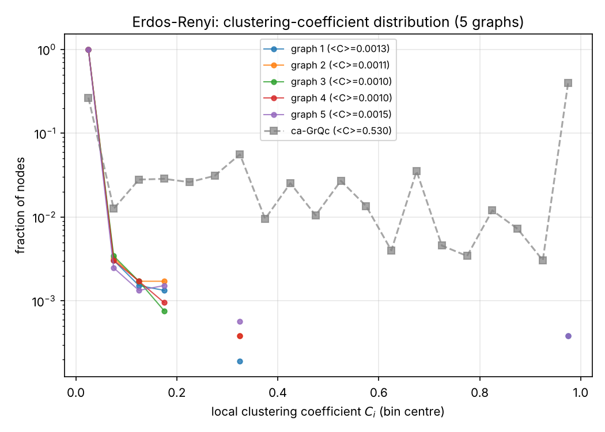
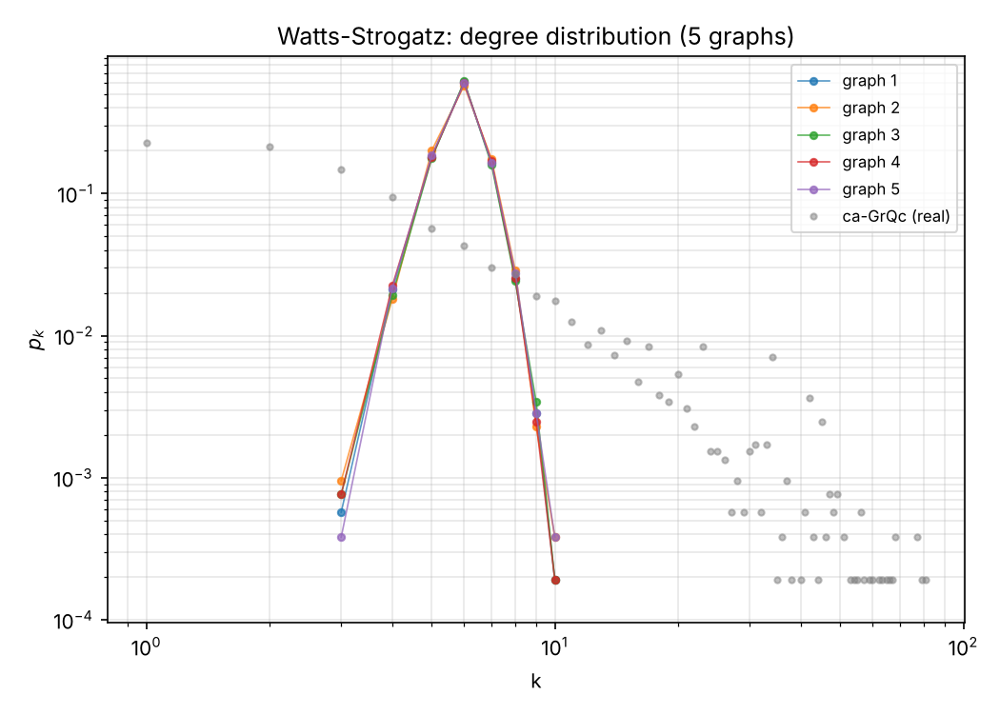
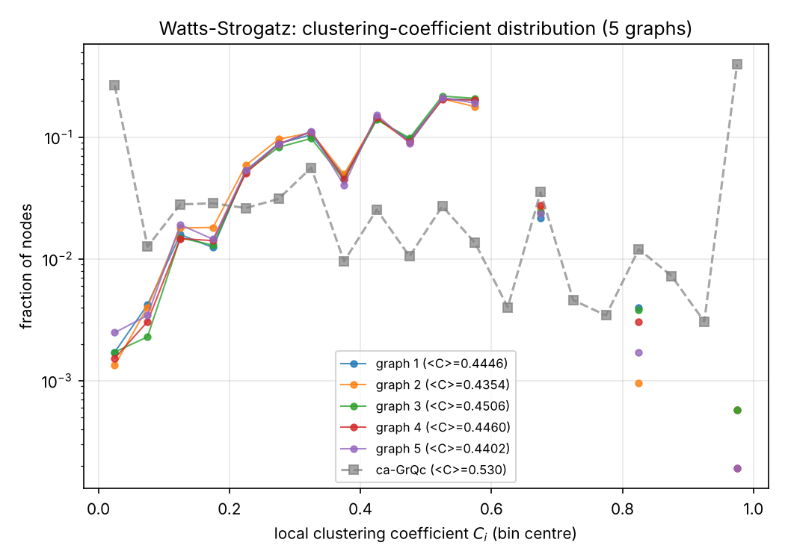
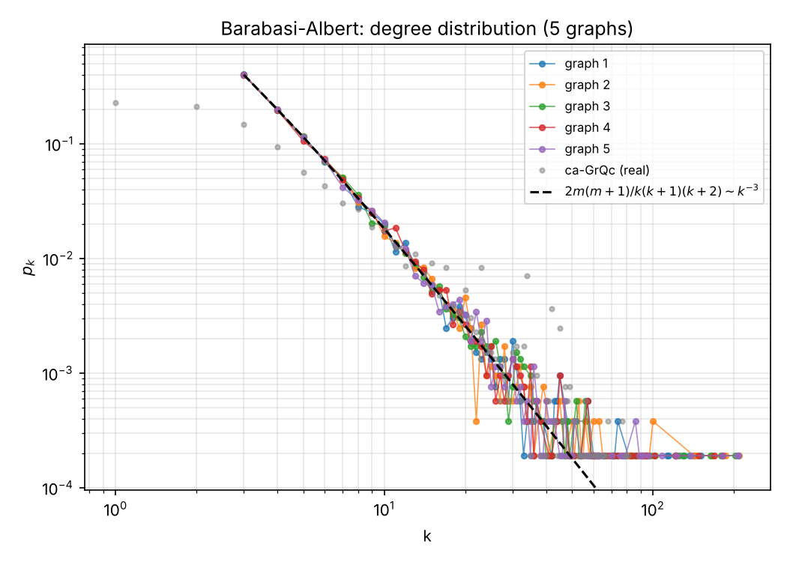
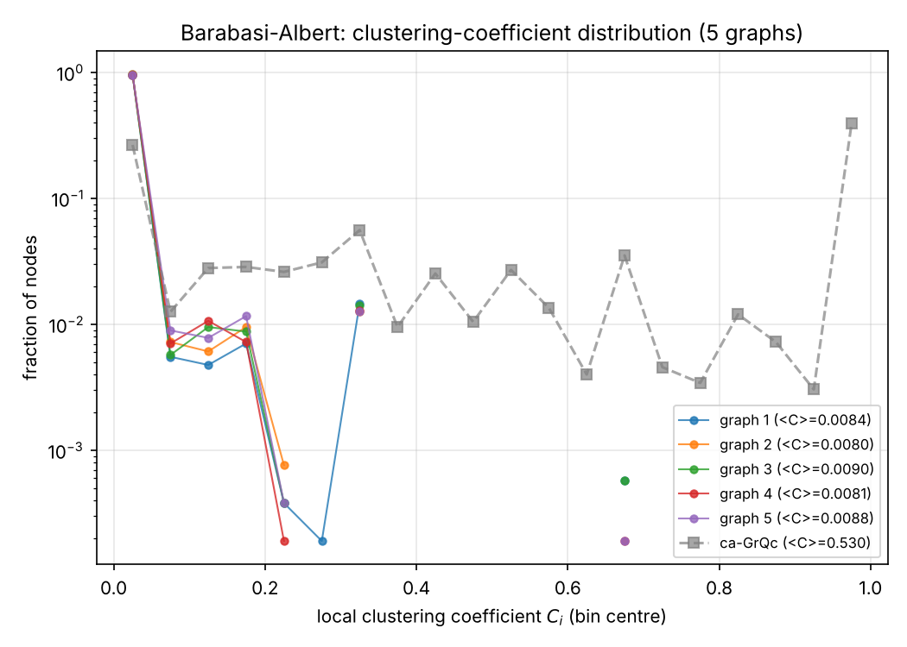

# Artificial network models vs. real networks

Do the classic random-graph models reproduce the structure of real networks?
This project compares three real networks from [SNAP](https://snap.stanford.edu/data/) with 15 synthetic graphs
(5 each of Erdős–Rényi, Watts–Strogatz and Barabási–Albert) built to have the same number of nodes and about the same number of edges as the smallest real network.

Everything is in one notebook: [`network_models_vs_real_networks.ipynb`](network_models_vs_real_networks.ipynb)
(outputs are included; it runs in about 2 minutes on a laptop or in Google Colab, datasets are downloaded automatically).

## Real networks

| Network | Type | N | L | ⟨k⟩ | Diameter | Radius | ⟨d⟩ | ⟨C⟩ | ln N / ln⟨k⟩ |
|---|---|---|---|---|---|---|---|---|---|
| ca-GrQc (arXiv GR co-authorship) | undirected | 5,242 | 14,484 | 5.53 | 17 | 9 | 6.05 | 0.530 | 5.01 |
| cit-HepTh (arXiv HEP-TH citations) | directed | 27,770 | 352,768 | 12.70 | 35 | 13 | 9.80 | 0.312 | 4.03 |
| com-DBLP (DBLP co-authorship) | undirected | 317,080 | 1,049,866 | 6.62 | 23 | 12 | 6.83* | 0.632 | 6.70 |

Self-loops are removed (12 in ca-GrQc, 39 in cit-HepTh), so L is slightly lower than the number on the SNAP page.
Diameter, radius and ⟨d⟩ are computed on the giant component (largest strongly connected component for the directed graph, following edge directions).
\*For DBLP, diameter and radius are exact (bounding-eccentricities algorithm, 9 BFS runs); ⟨d⟩ is estimated from 1,000 random BFS sources (standard error 0.03). Everything else is exact.



## Synthetic graphs (N = 5,242, target L = 14,484)

| Model | parameters | L (mean ± std, 5 graphs) | ⟨d⟩ | Diameter | ⟨C⟩ |
|---|---|---|---|---|---|
| Erdős–Rényi | p = 0.001054 | 14,468 ± 70 | 5.20 | 10.4 | 0.0012 |
| Watts–Strogatz | k = 6, β = 0.1 | 15,726 ± 0 | 7.94 | 13.8 | 0.443 |
| Barabási–Albert | m = 3 | 15,717 ± 0 | 4.08 | 7.0 | 0.0085 |
| *ca-GrQc (real)* | | *14,484* | *6.05* | *17* | *0.530* |

The number of edges cannot match exactly for WS (L = N·k/2 with k even) and BA (L = m(N−m) with m an integer), hence the +8.5 % difference.
For ER the edge count is random; its observed std (70) is below the theoretical 120 only because there are just 5 samples.

| Degree distribution | Clustering distribution |
|---|---|
|  |  |
|  |  |
|  |  |

## What the results show

* **Erdős–Rényi** matches the Poisson degree distribution almost exactly and has ⟨C⟩ ≈ ⟨k⟩/N ≈ 0.001, about 450 times lower than the real network. It gets short paths right but misses hubs and clustering.
* **Watts–Strogatz** reproduces the high clustering (0.44 vs 0.53) but its degrees are concentrated around 6, with no hubs.
* **Barabási–Albert** produces the heavy tail (p_k ∼ k⁻³, matching the theory curve) and short paths, but its clustering is almost as low as a random graph's.
* **Real networks** have all three properties at once: short paths, high clustering and a heavy-tailed degree distribution. None of the three models captures all of them.

Reference: A.-L. Barabási, *Network Science* (models chapters), and the SNAP datasets by J. Leskovec and A. Krevl.

## Run it

```bash
pip install -r requirements.txt
jupyter notebook network_models_vs_real_networks.ipynb
```
Tables (CSV) and figures (PNG) are written to `results/`.
